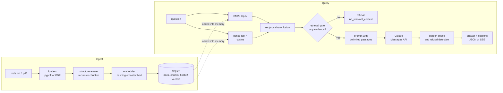

# hybrid-rag-api

[](https://github.com/rahulkumar96t/hybrid-rag-api/actions/workflows/ci.yml)

A small question-answering service over your own Markdown, text and PDF files. Documents
are split into chunks along their structure (headings, pages, paragraphs). Each question is
searched two ways, with BM25 keyword scoring and with dense embeddings, and the two rankings
are merged with reciprocal rank fusion. Claude then answers from the retrieved chunks only.
Every factual sentence must cite a chunk id, and the service refuses when the retrieved text
does not support an answer. It runs as a FastAPI service with a streaming (SSE) endpoint, or
as a CLI. The index lives in one SQLite file. An offline evaluation script measures retrieval
quality on a bundled question set.

## Features

- **Ingestion** of `.md`, `.txt` and `.pdf` (via `pypdf`). Re-ingesting an unchanged file is
  a no-op; a changed file replaces its old chunks in one transaction.
- **Structure-aware chunking.** Sections follow Markdown headings and PDF pages, and chunks
  never cross a section. Inside a section the text is split recursively, by paragraph, then
  line, then sentence, then word. Fenced code blocks are kept whole where possible. Chunks
  overlap by whole sentences, and each one keeps its heading path and exact character
  offsets.
- **Hybrid retrieval:** BM25 (Okapi, non-negative IDF) plus cosine similarity over
  embeddings, fused with reciprocal rank fusion (RRF). Each hit reports its rank and score
  from both retrievers.
- **Pluggable embedders:**
  - `hashing` is a deterministic feature-hashing embedder with no model download, used by
    the tests and for offline use.
  - `fastembed` runs a local ONNX sentence-embedding model (`BAAI/bge-small-en-v1.5` by
    default). It is behind an optional extra.
- **Persistent index:** one SQLite file holds documents, chunks and float32 vectors. The
  file records which embedder built it, and refuses to open with a different one.
- **Grounded answers with Claude**, through the `anthropic` SDK:
  - chunk-id citations are parsed and checked against what was actually retrieved;
  - an answer that cites nothing it was shown is turned into a refusal.
- **Refusals at three levels:**
  - a retrieval gate refuses without calling the model;
  - the model can reply with an explicit `INSUFFICIENT_CONTEXT` marker;
  - the API's own refusals (`stop_reason == "refusal"`) are handled.
- **SSE streaming** with `retrieval`, `token`, `done` and `error` events. When a reply
  starts with the refusal marker, none of it is streamed to the client.
- **Offline evaluation:** recall@k, MRR and refusal-gate rates on a bundled corpus and
  question set, for BM25, dense and hybrid retrieval.

## Architecture



| Module | Responsibility |
|---|---|
| `loaders.py` | file type detection, PDF text extraction, document ids |
| `chunking.py` | sections, recursive splitting, overlap packing, offsets |
| `text.py`, `bm25.py` | tokenizer (stop-words, plural folding, identifier splitting) and BM25 |
| `embeddings.py` | `Embedder` protocol, hashing and fastembed implementations |
| `fusion.py` | reciprocal rank fusion |
| `store.py` | SQLite persistence |
| `retrieval.py` | in-memory hybrid index rebuilt from the store after each write |
| `generation.py` | system prompt, passage rendering, citation parser, Claude adapter |
| `service.py` | the pipeline and its refusal rules |
| `api.py`, `cli.py` | FastAPI app and command line |
| `evaluation.py` | recall@k / MRR evaluation |

## Quickstart

Requires [uv](https://docs.astral.sh/uv/) and Python 3.11 or newer.

```bash
uv sync
uv run hybrid-rag-api ingest eval/corpus          # index the bundled sample docs
uv run hybrid-rag-api search "how long are finished jobs kept" -k 3

export ANTHROPIC_API_KEY=...                      # only needed for generated answers
uv run hybrid-rag-api ask "How many times is a failing job retried by default?"
uv run hybrid-rag-api serve                       # http://127.0.0.1:8000/docs
```

The bundled corpus describes **Tidewater**, a job queue invented for this repository.
Questions about it have known answers, and nothing in it overlaps with what a model might
already know.

Without credentials, the service still ingests, searches and serves `/search`; the
generation endpoints answer `503`.

## Usage

### HTTP API

```bash
# Upload documents (multipart). The whole batch is checked first; a bad file rejects it.
curl -F files=@handbook.md -F files=@manual.pdf http://127.0.0.1:8000/documents

# Retrieval only: hybrid, bm25 or dense
curl -s http://127.0.0.1:8000/search -H 'content-type: application/json' \
  -d '{"query": "readiness probe", "k": 3, "mode": "hybrid"}'

# Cited answer
curl -s http://127.0.0.1:8000/query -H 'content-type: application/json' \
  -d '{"question": "Which endpoint should a load balancer use as a readiness probe?"}'
```

A `/query` response looks like this (shortened):

```json
{
  "answer": "Use /readyz: it returns 200 only when the database is reachable and migrations are complete [observability:3].",
  "refused": false,
  "refusal_reason": null,
  "citations": [{"id": "observability:3", "source": "observability.md",
                 "section": "Observability > Health checks", "char_start": 923, "char_end": 1167}],
  "invalid_citations": [],
  "retrieved": [{"id": "observability:3", "score": 0.0328, "bm25_rank": 1, "dense_rank": 1, "...": "..."}],
  "model": "claude-sonnet-5-5"
}
```

The JSON above shows the response format; it is not a recorded model output.

Streaming:

```bash
curl -N http://127.0.0.1:8000/query/stream -H 'content-type: application/json' \
  -d '{"question": "What happens to scheduled runs missed while the server was down?"}'
```

```text
event: retrieval
data: [{"id": "scheduling:2", "section": "Scheduling recurring jobs > Missed runs", ...}]

event: token
data: "The catch_up setting decides ..."

event: done
data: {"answer": "...", "refused": false, "citations": [...], ...}
```

The `done` event is authoritative. Citations can only be checked once the whole answer
exists. So if a streamed answer turns out to cite nothing, `done` reports
`refused: true` / `uncited_answer`, and the client should replace the streamed text.

Other endpoints: `GET /health`, `GET /documents`, `DELETE /documents/{doc_id}`.

### CLI

```text
hybrid-rag-api [--index PATH] ingest PATH...      # files or directories
hybrid-rag-api [--index PATH] search QUERY [-k N] [--mode hybrid|bm25|dense]
hybrid-rag-api [--index PATH] ask QUESTION [--json]
hybrid-rag-api [--index PATH] docs | delete DOC_ID | serve [--host H --port P]
hybrid-rag-api eval [--embedder hashing,fastembed] [--modes bm25,dense,hybrid] [-k 1,3,5]
```

### Configuration

All settings come from environment variables. The API key is read only from the
environment, through the Anthropic SDK's standard credential chain (`ANTHROPIC_API_KEY`,
`ANTHROPIC_AUTH_TOKEN`, or an `ant auth login` profile). No flag or config file accepts a
key.

| Variable | Default | Meaning |
|---|---|---|
| `RAG_INDEX_PATH` | `data/index.sqlite` | index file (`--index` overrides it) |
| `RAG_EMBEDDER` | `hashing` | `hashing[:dim]` or `fastembed[:model]` |
| `RAG_MODEL` | `claude-sonnet-5-5` | Claude model id |
| `RAG_EFFORT` | `low` | `output_config.effort`; `none` omits it for models without effort support |
| `RAG_FALLBACKS` | `default` | server-side refusal fallback; `off` disables it |
| `RAG_MAX_TOKENS` | `16000` | response cap, which includes thinking |
| `RAG_CHUNK_WORDS` / `RAG_OVERLAP_WORDS` | `200` / `40` | chunk size and overlap, in words |
| `RAG_TOP_K` / `RAG_CANDIDATES` / `RAG_RRF_K` | `5` / `30` / `60` | passages sent to the model, per-retriever candidates, RRF constant |
| `RAG_MIN_DENSE_SCORE` | per embedder | dense similarity that counts as evidence for the retrieval gate |
| `RAG_REQUIRE_CITATIONS` | `true` | refuse answers that cite no retrieved chunk |

**Refusal fallback is on by default.** Requests go through the SDK's beta Messages endpoint
with `fallbacks="default"` and the `server-side-fallback-2026-07-01` beta. If Claude's
safety classifiers decline a request, the API re-runs it on a fallback model that Anthropic
recommends, instead of returning the refusal. This is available on the Claude API only.
Set `RAG_FALLBACKS=off` to use the plain endpoint, for example with a model or platform
that does not support it. A refusal that still comes back is reported as
`refusal_reason: "model_refusal"`.

## Evaluation

`eval/qa.jsonl` holds 40 questions about the bundled corpus (9 files, about 1,850 words):

- 34 answerable questions, labelled with the document and section that contain the answer.
  Many use different words from the source text, for example "how long are finished jobs
  kept before they are deleted" for a section about retention and purging.
- 6 questions the corpus cannot answer.

Relevance is judged per section, so the labels stay valid if the chunk size changes.

- **recall@k**: the share of a question's labelled sections that have a chunk in the top k,
  averaged over the answerable questions. Two questions have two labels, so they can score
  at most 0.5 at k = 1.
- **MRR**: the mean of 1 / (rank of the first relevant chunk), computed over the top 5.
- **gate**: how often the retrieval gate would refuse before calling the model. It should
  fire on unanswerable questions and never on answerable ones.

No LLM is called, so the run is cheap. With the hashing embedder it is also deterministic.

```bash
uv run hybrid-rag-api eval                                    # hashing embedder, about 1 s
uv sync --extra fastembed
uv run hybrid-rag-api eval --embedder hashing,fastembed       # downloads bge-small (about 65 MB) once
```

Measured on 2026-10-30 on an Apple M4 Pro (macOS 27.2) with Python 3.12.11, fastembed
0.9.1 and onnxruntime 1.31.1. The run used the default settings: 200-word chunks with a
40-word overlap, which gives 37 chunks, and 30 candidates per retriever.

| mode | embedder | recall@1 | recall@3 | recall@5 | MRR | gate (unanswerable) | gate (answerable) |
|---|---|---|---|---|---|---|---|
| bm25 | – | 0.824 | 0.926 | 0.926 | 0.897 | 2/6 | 0/34 |
| dense | hashing-1024 | 0.765 | 0.956 | 0.956 | 0.877 | 6/6 | 3/34 |
| hybrid | hashing-1024 | 0.824 | 0.926 | 0.956 | 0.903 | 2/6 | 0/34 |
| dense | bge-small-en-v1.5 | 0.868 | 0.926 | 0.956 | 0.914 | 5/6 | 0/34 |
| hybrid | bge-small-en-v1.5 | 0.794 | 0.956 | 0.985 | 0.893 | 2/6 | 0/34 |

How to read these numbers:

- **The set is tiny.** One question is worth about 0.03 recall, so most gaps in the table
  are one or two questions. Treat it as a regression check and a worked example, not a
  benchmark.
- **The hashing embedder does not understand meaning.** Its "dense" channel only adds
  sub-word and word-pair overlap. It still helped on this set: recall@5 went from 0.926 to
  0.956.
- **No single mode wins everywhere.** With the real embedder, hybrid had the best recall at
  k = 3 and k = 5, and dense-only had the best recall@1. RRF does not always beat its best
  input at rank 1.
- **The retrieval gate is coarse by design.** In hybrid mode it caught 2 of the 6
  unanswerable questions. The others share words with the corpus ("payload", "job"), so it
  lets them through, and the model's `INSUFFICIENT_CONTEXT` reply has to catch them.
  That end-to-end behaviour needs the API and is not measured here. The opt-in live test
  checks it on two questions.

## Design decisions and trade-offs

- **RRF instead of mixing scores.** BM25 scores have no fixed range and cosine scores sit
  in [-1, 1]. Rank fusion needs no calibration and no tuning beyond `k = 60`, the constant
  from the original paper. It ignores how far apart the scores are; a weighted score blend
  could use that, but needs per-corpus tuning.
- **Contextual headers.** Before BM25 and embedding, each chunk is prefixed with its
  document title and heading path. A short paragraph under "Retries > Backoff" then still
  matches a question about retry backoff. The model sees the same path as a `section`
  attribute on the passage.
- **Chunks are character ranges, not copies.** The splitter works on offsets into the
  original text, so overlap is exact and every citation maps back to a source span.
  Overlap is counted in whole sentences or lines, up to the word budget, rather than
  cutting mid-sentence.
- **SQLite with vectors as BLOBs.** One file and one transaction per document, so the
  index never holds vectors for deleted chunks. The cost is that search runs on an
  in-memory copy that is rebuilt after each write (O(corpus)). That is fine for thousands
  of chunks; for millions, use an ANN index such as HNSW.
- **Refusing is part of the contract.**
  - The retrieval gate saves a model call when there is clearly nothing relevant.
  - The prompt tells the model to answer only from the passages, to cite each fact, and to
    treat passage text as data. Passage delimiters inside documents are escaped.
  - Code then checks the citations. An answer that cites nothing it was shown becomes a
    refusal, with the text kept in `raw_answer` for debugging.
- **Inline citation markers, not the API's citation blocks.** `[doc:3]` markers work
  identically when streaming and when not, are easy to test, and keep the passage ids
  stable and readable. The trade-off is that the model can invent an id. The parser reports
  any invented ids as `invalid_citations`.
- **Claude request shape:**
  - no `temperature` or other sampling parameters: the current API version rejects them;
  - no `thinking` parameter: the default model thinks adaptively;
  - `effort` is set explicitly (`low`, the recommended starting point for search and Q&A
    work);
  - every response is checked for `stop_reason == "refusal"` before its content is read.
- **Fakes, not mocks.** The service depends on a two-method `AnswerModel` protocol. Tests
  use a scripted fake, and the Claude adapter is tested against a fake SDK client that
  records the exact request parameters.

## Testing

```bash
uv run ruff check . && uv run ruff format --check . && uv run pytest -q
```

100 tests pass and 1 live test is skipped. The suite needs no network, API key or model
download. It covers:

- chunking: sections, fences, overlap, offsets, PDF pages;
- tokenizer, BM25 and RRF arithmetic;
- the hashing embedder and SQLite persistence, including the embedder-mismatch guard;
- PDF loading, using a PDF generated inside the test;
- citation parsing and prompt escaping;
- the request parameters the Claude adapter sends;
- every refusal path, including the streaming marker suppression;
- all HTTP endpoints through FastAPI's `TestClient`, including SSE parsing and the 413, 415,
  422, 502 and 503 errors;
- the evaluation metrics and the CLI.

CI runs on Python 3.11 and 3.13 and also runs the offline evaluation.

`tests/test_live_claude.py` makes real API calls. It runs only when both
`ANTHROPIC_API_KEY` and `RUN_LIVE_TESTS=1` are set.

## Limitations and roadmap

- **No real Claude call was made while building this.** The request shape follows the
  current SDK (`anthropic` 2.3) and is checked with fakes; the live test is the way to
  confirm it against the API.
- **PDF text extraction is `pypdf`'s plain mode.** Scanned PDFs (no text layer), complex
  tables and multi-column layouts come out poorly, and there is no OCR.
- **Markdown structure covers ATX (`#`) headings only.** Setext headings and HTML are
  treated as body text.
- **Search time grows linearly with corpus size**, for both the vector search and the
  rebuild after each write. Next steps would be an ANN index (HNSW) and incremental BM25
  updates.
- **The tokenizer is English-centric:** English stop-words and plural folding only.
- **Possible additions:**
  - a cross-encoder or LLM reranking stage after fusion;
  - an end-to-end answer evaluation (faithfulness and refusal accuracy) that calls the
    model;
  - API authentication and rate limiting before any shared deployment. There are none
    today.

## License

MIT. See [LICENSE](LICENSE).
